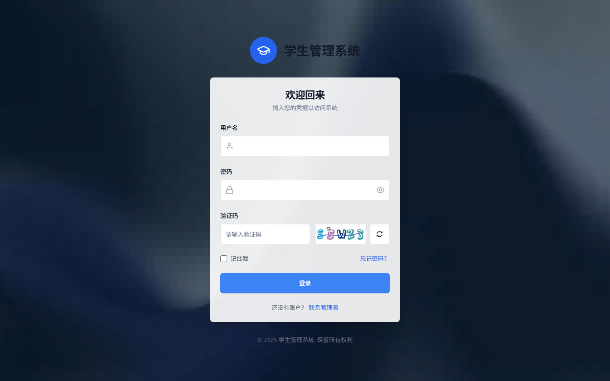
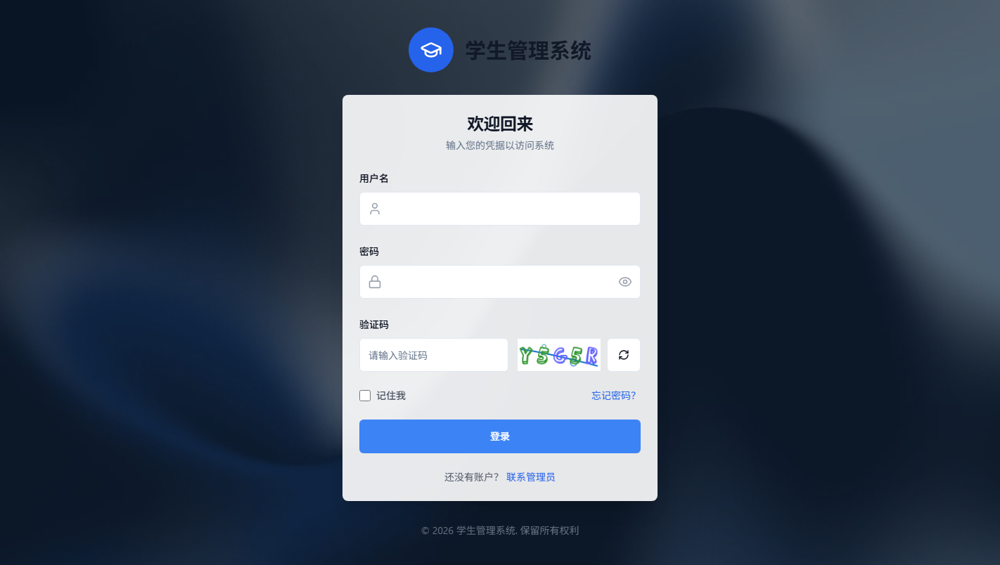
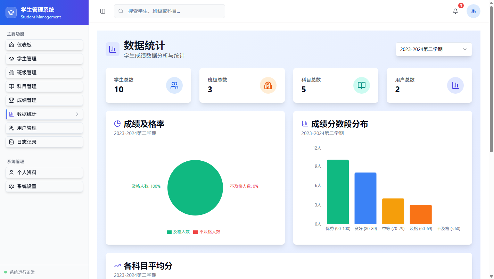
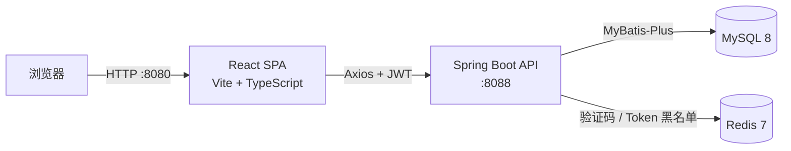

# 学生管理系统（SMS）

[](https://github.com/Ricardo-Kaslana/sms-react/actions/workflows/ci.yml)
[](LICENSE)
[](https://openjdk.org/)
[](https://spring.io/projects/spring-boot)
[](https://react.dev/)

一个前后端分离的学生管理系统（Student Management System），后端基于 Spring Boot + MyBatis-Plus + Shiro + JWT，前端基于 React 18 + TypeScript + Vite + shadcn/ui。适合作为课程设计、实训项目或 Java Web 全栈学习示例。

## 功能特性

- **认证与授权**：图形验证码登录、JWT 无状态认证、Redis Token 黑名单登出、Shiro 注解式角色鉴权
- **角色体系**：管理员（`ROLE_ADMIN`）与教师（`ROLE_TEACHER`），不同角色拥有不同操作权限
- **基础数据管理**：学生、班级、科目、成绩的增删改查、分页与条件筛选
- **数据统计**：学生/班级/科目/用户总数、及格率、科目平均分、分数段分布，支持按学期切换
- **个人中心**：修改资料、上传头像、修改密码
- **操作日志**：通过 AOP 自动记录关键操作，管理员可查看与导出
- **现代化前端**：React Router、React Query、Axios、Tailwind CSS、shadcn/ui，响应式布局

## 界面预览

### 登录页



### 管理后台



### 数据统计



## 技术栈

| 层级 | 技术 |
| --- | --- |
| 前端 | React 18、TypeScript、Vite 5、React Router 6、Axios、shadcn/ui、Tailwind CSS、Recharts |
| 后端 | Java 17、Spring Boot 2.7.18、MyBatis-Plus 3.5、Apache Shiro 1.12、JJWT 0.11 |
| 数据存储 | MySQL 8.0、Redis 7 |
| 构建与部署 | Maven、Yarn、Docker Compose、GitHub Actions |

## 系统架构



## 目录结构

```text
SmsReact/
├── backend/                       # Spring Boot 后端
│   ├── src/main/java/cn/lvb/education/
│   │   ├── aspect/                # 操作日志 AOP
│   │   ├── config/                # Shiro、MyBatis-Plus、Web MVC 等配置
│   │   ├── controller/            # REST 接口
│   │   ├── entity/ dto/ vo/       # 数据模型
│   │   ├── mapper/ service/       # 数据访问与业务逻辑
│   │   └── security/              # JWT 过滤器、Realm、登录凭证
│   └── src/main/resources/
│       ├── application.yaml       # 应用配置（支持环境变量）
│       ├── db/                    # schema.sql / data.sql
│       └── mapper/                # MyBatis XML
├── frontend/                      # React 前端
│   ├── src/components/            # 布局、业务组件与 shadcn/ui 组件
│   ├── src/pages/                 # 页面
│   ├── src/services/api.ts        # API 封装
│   └── .env.example               # 前端环境变量示例
├── docker-compose.yml             # MySQL + Redis 一键启动
└── .github/workflows/ci.yml       # 前后端构建 CI
```

## 快速开始

### 1. 环境要求

- JDK 17+
- Maven 3.8+
- Node.js 18+、Yarn 1.22+
- MySQL 8.0+
- Redis 7+（或使用 Docker Compose）

### 2. 启动 MySQL 与 Redis

**方式 A：Docker Compose（推荐）**

```bash
docker compose up -d
```

首次启动会自动创建数据库并导入 `schema.sql` 与 `data.sql`。

**方式 B：使用本机服务**

```bash
# 初始化数据库（会重建表结构）
mysql -uroot -p < backend/src/main/resources/db/schema.sql
mysql -uroot -p < backend/src/main/resources/db/data.sql

# 启动 Redis
redis-server
```

> 如果本机已有 MySQL/Redis 占用 `3306`/`6379`，请先停止对应服务；也可以通过 `MYSQL_PORT`、`REDIS_PORT` 修改 Compose 映射端口，并同步调整后端连接配置。

### 3. 启动后端

```bash
cd backend
mvn spring-boot:run
```

后端默认运行在 <http://localhost:8088>，使用以下默认连接：

- MySQL：`localhost:3306/student_management_system`，用户名/密码 `root/root`
- Redis：`localhost:6379`，数据库 `0`

生产或本地自定义环境请通过环境变量覆盖，见下方[配置说明](#配置说明)。

### 4. 启动前端

```bash
cd frontend
yarn install
yarn dev
```

访问 <http://localhost:8080>。如需修改后端地址，将 `.env.example` 复制为 `.env` 并调整 `VITE_API_BASE_URL`。

### 演示账号

| 角色 | 用户名 | 密码 |
| --- | --- | --- |
| 管理员 | `admin` | `123456` |
| 教师 | `teacher` | `123456` |

> 演示账号仅用于本地体验，部署到公网前请立即修改密码，并用高强度随机值替换 `JWT_SECRET`。

## 配置说明

### 后端环境变量

| 变量 | 默认值 | 说明 |
| --- | --- | --- |
| `SERVER_PORT` | `8088` | 后端端口 |
| `DB_URL` | `jdbc:mysql://localhost:3306/student_management_system?...` | JDBC 连接串 |
| `DB_USERNAME` | `root` | 数据库用户名 |
| `DB_PASSWORD` | `root` | 数据库密码 |
| `REDIS_HOST` | `localhost` | Redis 地址 |
| `REDIS_PORT` | `6379` | Redis 端口 |
| `REDIS_DATABASE` | `0` | Redis 数据库编号 |
| `JWT_SECRET` | 内置开发用值 | JWT 签名密钥，**生产环境必须覆盖** |
| `JWT_EXPIRE` | `86400` | Token 有效期（秒） |
| `FILE_UPLOAD_DIR` | `./uploads` | 头像上传目录 |
| `LOG_LEVEL` | `info` | 业务包日志级别 |

示例（Linux / macOS）：

```bash
export DB_PASSWORD=your_password
export JWT_SECRET=$(openssl rand -hex 32)
cd backend && mvn spring-boot:run
```

PowerShell：

```powershell
$env:DB_PASSWORD = "your_password"
$env:JWT_SECRET = "your-random-secret"
cd backend; mvn spring-boot:run
```

### 前端环境变量

在 `frontend/.env` 中配置：

```bash
VITE_API_BASE_URL=http://localhost:8088
```

## API 概览

所有业务接口返回统一结构：`{ "code": 200, "message": "success", "data": ... }`。
除 `/user/login` 与 `/captcha` 外，请求需携带请求头 `Authorization: <JWT>`（不带 `Bearer ` 前缀）。

| 模块 | 方法与路径 | 说明 |
| --- | --- | --- |
| 验证码 | `GET /captcha` | 获取图形验证码（key + Base64 图片） |
| 认证 | `POST /user/login` | 登录并获取 JWT |
| 认证 | `POST /user/logout` | 登出并将 Token 加入黑名单 |
| 个人中心 | `GET/PUT /user/profile` | 查询/修改个人资料 |
| 个人中心 | `PUT /user/password` | 修改密码 |
| 个人中心 | `POST /user/avatar` | 上传头像 |
| 用户管理 | `GET /user/page` 等 | 仅管理员 |
| 学生 | `GET /student/page`、`GET /student/list` 等 | 学生管理 |
| 班级 | `GET /class/page`、`GET /class/list` 等 | 班级管理 |
| 科目 | `GET /subject/page`、`GET /subject/list` 等 | 科目管理 |
| 成绩 | `GET /grade/page`、`GET /grade/terms` 等 | 成绩管理与学期列表 |
| 统计 | `GET /statistics/dashboard?term=...` | 仪表盘统计数据 |
| 日志 | `GET /log/page`、`GET /log/export` | 仅管理员 |

## 常见问题

**登录提示“验证码错误或已过期”**
验证码保存在 Redis 中，请确认 Redis 已启动，且 `REDIS_HOST`、`REDIS_PORT`、`REDIS_DATABASE` 配置正确。验证码有效期为 2 分钟。

**头像上传成功但页面不显示**
头像默认保存到后端启动目录下的 `uploads/`，并通过 `/avatars/**` 暴露。确认前端 `VITE_API_BASE_URL` 指向正确的后端地址，且后端进程对上传目录有写权限。

**忘记密码 / 想重置演示账号密码**
运行 `backend/src/main/java/cn/lvb/education/PasswordEncodingTest.java` 的 `main` 方法，会输出密码 `123456`（或传入自定义参数）的 BCrypt 哈希，将哈希更新到 `t_user.password` 即可。

**前端跨域请求失败**
开发环境已开启跨域支持。若使用自定义域名或生产环境，请收敛 `WebMvcConfig` 与 `JwtFilter` 中的 CORS 规则，只允许受信任的来源。

**数据库脚本可以重复执行吗？**
`schema.sql` 会先删除旧表再重建，请勿在生产环境执行。需要重置演示数据时，依次重新执行 `schema.sql` 和 `data.sql`。

## 安全说明

本项目定位为学习与演示项目，默认配置仅适合本地开发：

- 默认数据库密码、JWT 密钥和演示账号必须在部署前更换
- 生产环境建议为 Redis 设置密码，并关闭公网直接访问
- CORS 当前允许所有来源，生产环境应限制为前端域名
- 头像上传已限制为常见图片格式与 2MB 以内，如需更高安全性可接入对象存储与病毒扫描

## 参与贡献

欢迎提交 Issue 与 Pull Request。提交前请确保以下命令通过：

```bash
cd backend && mvn -B -DskipTests package
cd frontend && yarn build
```

## 许可证

本项目基于 [MIT License](LICENSE) 开源。
